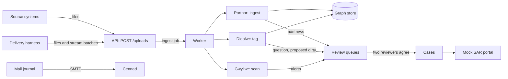

# How it works

## The path a record takes

1. **A file arrives** at `POST /uploads`. The API stores it under its SHA-256, records a
   `SourceFile`, and queues an `ingest` job. The same bytes are accepted once; a second upload
   answers `duplicate`.
2. **The worker runs the ingest job.** Porthor detects the format and dataset, maps
   source-system column names to the canonical ones, validates every row and writes `Record`,
   `Device`, `Identifier`, `Person` and `EmailAddress` nodes. A row that fails becomes an
   `IngestError` and a review item. A record already known is linked to the new file, not loaded
   twice. A file that cannot be parsed at all becomes one review item.
3. **Ingest queues a tag job.** Didolwr reads a pseudonymised extract of the file's records, scans
   them against the trigger list, and (if a model is configured) asks the ethics judge. It writes
   one tag per record. *Question* tags that need a person, and every proposed *dirty* tag, become
   review items.
4. **Scans run on a schedule** (daily and weekly) or on demand. Gwyliwr reads an extract with no
   message content, computes concern rates and graph signals over a time window, and raises alerts.
5. **Reviewers decide.** Their decisions write tags, resubmit corrected rows, or open cases.
6. **Investigators work cases**, and a nominated officer approves any report.

## Components

| Package | Name | What it is |
|---|---|---|
| `uniondeb-core` | | Record contracts (Pydantic models), identifiers, the alias layer that maps source-system column names, provenance types, logging set-up |
| `uniondeb-store` | Tarddiad (provenance) | Neo4j/AuraDB and embedded Relate runners, migrations, database roles, provenance, append-only tags, review queues, field encryption, backup and restore |
| `uniondeb-extract` | Echdynnwr | Extract contracts and the builder that cuts read-only, pseudonymised extracts for agents |
| `uniondeb-mail` | Cennad | SMTP journal receiver, Microsoft 365 and Google Workspace parsers, raw mail store, publisher |
| `uniondeb-agents` | Porthor, Didolwr, Gwyliwr, Crynhoi, Holwr | Ingest, tagging, security scans, case packs, case question-answering |
| `uniondeb-cases` | Ymchwiliad | Cases, conflict-checked assignment, flags, the hash-chained audit log, SAR drafts and the mock portal |
| `uniondeb-worker` | | The job queue, job handlers, scheduler and retention |
| `uniondeb-api` | | The HTTP API, the review console (`/console`) and the investigation portal (`/portal`) |
| `uniondeb-evals` | Arholwr | The offline evaluation gate and the online agreement report |
| `uniondeb-synth` | | Synthetic traffic with ground truth |
| `ext_harness` | | The [delivery harness](run-harness.md): a separate FastAPI application that feeds files and streams to the API |

All packages share the namespace `uniondeb.*` and one command, `uniondeb`.

## Processes

Two long-running processes and one database:

- **API** (`uniondeb api serve`): FastAPI. Serves the JSON API and the two server-rendered user
  interfaces. It never runs an agent itself; it queues jobs.
- **Worker** (`uniondeb worker run`): claims jobs from the queue and runs them: `ingest`, `tag`,
  `scan`, `reap` (delete expired extracts), `retention` and `audit_verify`. It also enqueues the
  scheduled jobs: the audit check after 01:00, the daily scan after 02:00, the weekly scan on
  Monday after 03:00 and retention after 04:00.
- **Graph store**: AuraDB in production, Neo4j Enterprise in development. The job queue is `Job`
  nodes in the same database, so there is no separate broker
  ([ADR 0003](adr/0003-one-store-one-process-family.md)).

Cennad (`uniondeb cennad serve`) is a third, optional process for journaled email.

## The data model

The graph is the system of record. The main node types:

| Node | Holds |
|---|---|
| `SourceFile` | One uploaded file or raw email, keyed by SHA-256, with its state and row counts |
| `Record` | One call, message, hand-off step or email. Content fields are encrypted |
| `Device`, `Identifier`, `EmailAddress`, `Person` | Who and what took part. `Person` comes from the roster |
| `Tag` | One judgement about a record. `current: true` marks the one in force |
| `ReviewItem` | Something waiting for a person, with the decisions made on it |
| `Alert`, `Scan` | What a scan found, about a pseudonym |
| `Case`, `CaseNote`, `Flag`, `SarDraft`, `SarSubmission` | An investigation |
| `AuditEvent` | One entry in the hash chain |
| `Activity`, `SoftwareAgent` | Provenance: what ran, with which versions, using and generating what |
| `Job` | A queued or finished unit of work |
| `Extract`, `ExtractContract` | An agent extract and the contract it was cut from |

Every statement is auto-committed. Properties are scalars or lists; anything structured is stored
as a JSON string. Timestamps are ISO 8601 strings.

### Provenance

Every write happens inside an *activity* that records the agent, its version, the model and prompt
version if any, the configuration versions, what it used and what it generated. From any record,
tag or case note you can walk back to the SHA-256 of the file it came from. The portal shows this
per record.

### Extracts and contracts

An agent never queries the graph. Echdynnwr runs a contract's read-only Cypher, checks that the
result has exactly the declared columns and none of the properties forbidden to that agent,
replaces names with stable pseudonyms, and writes an embedded Relate file that the agent opens
read-only. Extracts expire and are reaped
([ADR 0002](adr/0002-relate-agent-extracts.md)).

| Contract | Used by | Contains |
|---|---|---|
| `porthor.dedupe.v1` | Porthor | Keys and content hashes, to recognise records already loaded |
| `didolwr.tag-batch.v1` | Didolwr | One file's records with text, pseudonymised |
| `gwyliwr.scan.v1` | Gwyliwr | Metadata and tags over a window; no content |
| `crynhoi.case-pack.v1` | Crynhoi | One subject's records over a window |
| `ymchwiliad.case.v1` | Holwr | One case's records |

## The agents

| Agent | Deterministic part | Needs a model for |
|---|---|---|
| **Porthor** | Format detection, alias resolution, validation, deduplication, error capture | Proposing a column mapping for an unknown dialect (a person approves it) |
| **Didolwr** | Trigger-list scan (English and Welsh), routing | The ethics judgement that can propose *dirty* |
| **Gwyliwr** | Everything: metrics and graph signals | Nothing |
| **Crynhoi** | The pack's timeline and evidence table | The narrative summary |
| **Holwr** | | Answering an investigator's question about a case; drafting a SAR narrative |

A model is used only when one is named (see [Configuration](reference/configuration.md)). Without
one, ingest, trigger tagging, scans, review and investigation all still work.

## Review rules

| Queue | Decisions | Two reviewers? |
|---|---|---|
| `ingest_error`, `mail_dlq` | `fix_resubmit`, `reject`, `source_issue` | No |
| `mapping_proposal` | `approve`, `reject` | No |
| `question_tag` | `clear`, `escalate` (creates a `dirty_tag` item) | No |
| `dirty_tag` | `confirm_dirty`, `downgrade_question`, `downgrade_clean`, `needs_info` | Yes |
| `alert` | `dismiss`, `open_case`, `escalate_legal` (compliance lead only) | Yes |

## Security model

- **Authentication**: OIDC bearer tokens checked against the provider's keys. For development, a
  shared secret signs tokens (`uniondeb api token`). With neither configured the API will not start.
- **Roles**: `uploader`, `reviewer`, `compliance`, `compliance_lead`, `investigator`,
  `nominated_officer`, `auditor`, `case_admin`, `service`.
- **Encryption**: record content and case packs are encrypted with a Fernet key before they reach
  the database.
- **Audit**: each event carries the hash of the one before it. `uniondeb audit verify` checks the
  chain; `uniondeb audit anchor` writes a signed copy of its head to keep elsewhere.

Open findings are in the [security review](security-review.md).
