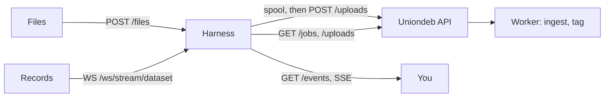

# Sending data through the delivery harness

The delivery harness (`ext_harness/`) is a separate FastAPI application that stands where a source
system would. It accepts files and record streams, forwards them to Uniondeb's `POST /uploads` as
an `uploader`, follows each one through ingest, and reports progress as server-sent events.



Uniondeb has no streaming intake over HTTP, so the harness cuts a stream into JSON-lines files
(every 500 records, or after 5 seconds of silence) and delivers each as an upload.

## Start it

With the stack running ([Getting started](getting-started.md)):

```sh
set -a; . deploy/.env; set +a          # the harness mints its uploader token from UNIONDEB_AUTH_SECRET
uv run python -m ext_harness serve     # http://127.0.0.1:8090
```

Open <http://127.0.0.1:8090> for a status page with an upload form and a live table, or check
from the command line:

```sh
curl http://127.0.0.1:8090/health
```

```json
{"harness": "ok", "uniondeb_url": "http://127.0.0.1:8000",
 "uniondeb": {"reachable": true, "authorised": true, "sub": "ext-harness", "roles": ["uploader"]}}
```

## Deliver files

```sh
uv run python -m ext_harness send data/run-001/data --watch
```

`send` takes files or folders. For a folder it sends every `.jsonl`, `.csv` and `.parquet` file
beneath it, and takes the dataset from the folder name (`…/calls/…`). `--watch` waits for every
delivery to finish and exits non-zero unless all were ingested or were duplicates.

```
accepted  data/run-001/data/normal/handoff/date=2026-10-05/part-0000.csv
…
ingested  data/run-001/data/normal/handoff/date=2026-10-05/part-0000.csv  rows 16, loaded 15, in review 1, linked 0
111 ingested
```

Or with any HTTP client:

```sh
curl -F "files=@part-0000.jsonl" -F "files=@part-0001.csv" -F dataset=messages \
     http://127.0.0.1:8090/files
```

## Stream records

```sh
uv run python -m ext_harness stream data/streams/mail-journal.ndjson --dataset email --watch
uv run python -m ext_harness stream data/streams/calls.ndjson --dataset calls --rate 50 --batch 100
```

The WebSocket endpoint is `/ws/stream/{dataset}`, where the dataset is `calls`, `messages`,
`handoff` or `email`. Query parameters: `batch` (records per file) and `source_system`.

Client to server, as text frames:

- a JSON object (one record), or a JSON array of records
- `{"$control": "flush"}` to cut a batch now
- `{"$control": "close"}` to flush and end the stream

Server to client:

- `{"type": "batch", "delivery_id": "…", "records": 500, "received": 500}` for each file cut
- `{"type": "rejected", "reason": "…", "frame": "…"}` for a frame that is not a record
- `{"type": "closed", "received": N, "rejected": N, "batches": N}` at the end

A batch is acknowledged when it is spooled, not when Uniondeb has ingested it. Watch the events
for the outcome.

## Watch status

```sh
uv run python -m ext_harness watch          # every event as it happens
curl -N http://127.0.0.1:8090/events        # the raw server-sent events
```

| Endpoint | |
|---|---|
| `GET /events` | Every event. A reconnecting client resumes after its `Last-Event-ID`, or `?after=N`. `?replay=false` gives new events only |
| `GET /deliveries/{id}/events` | One delivery; the response ends when it reaches a final state |
| `GET /deliveries`, `GET /deliveries/{id}` | Current state as JSON; `?state=` filters |
| `POST /deliveries/{id}/retry` | Send again after `rejected`, `failed` or `undeliverable` |

An event carries the whole delivery each time it changes:

```
id: 42
event: delivery
data: {"id":"8d5ddd3c4904","source":"stream","filename":"stream-email-….jsonl","dataset":"email",
       "state":"ingested","uniondeb":{"rows":500,"loaded":500,"in_review":0,"linked":0}}
```

| State | Meaning |
|---|---|
| `received`, `forwarding`, `queued`, `ingesting` | On its way |
| `ingested` | Uniondeb loaded it. `uniondeb` has the row counts |
| `duplicate` | Uniondeb already holds the same bytes |
| `unreadable` | Uniondeb took the file but could not parse it; it is one item in the ingest review queue |
| `rejected` | Uniondeb refused the upload; `detail` has its reason |
| `failed` | The ingest job died; `detail` has the error |
| `undeliverable` | Uniondeb could not be reached after the retries; the file stays in the spool for a retry |

## Settings

| Variable | Default | |
|---|---|---|
| `HARNESS_UNIONDEB_URL` | `http://127.0.0.1:8000` | The Uniondeb API |
| `HARNESS_UNIONDEB_TOKEN` | | A bearer token with the `uploader` role |
| `UNIONDEB_AUTH_SECRET` | | Development only: used to mint five-minute `uploader` tokens when no token is set |
| `HARNESS_API_KEY` | | When set, callers must send it as `X-API-Key` (or `?key=` for browser SSE and WebSocket clients) |
| `HARNESS_SPOOL` | `data/harness-spool` | Where files wait until Uniondeb has them |
| `HARNESS_BATCH_RECORDS`, `HARNESS_BATCH_SECONDS` | `500`, `5` | How a stream is cut into files |
| `HARNESS_WORKERS`, `HARNESS_RETRIES`, `HARNESS_RETRY_SECONDS` | `2`, `5`, `2` | Forwarding concurrency and backoff |
| `HARNESS_POLL_SECONDS`, `HARNESS_POLL_TIMEOUT` | `2`, `900` | How ingest is followed |
| `HARNESS_MAX_UPLOAD_BYTES` | 512 MiB | |
| `HARNESS_KEEP_DELIVERED` | `0` | `1` keeps spooled files after ingest |

The client commands take `--url` (or `HARNESS_URL`) and `--key` (or `HARNESS_API_KEY`).

## Limits

- It is a test harness. Without `HARNESS_API_KEY`, anyone who can reach the port can deliver as
  the harness's uploader identity, so it binds to `127.0.0.1` by default.
- Deliveries and event history are held in memory. After a restart, files still in the spool are
  not picked up again; send them again.
- [Load the roster](test-data.md#the-roster) before running a scan: files carry devices, not
  the people who own them.

## Next

[Review, scans and cases](review-and-cases.md).
